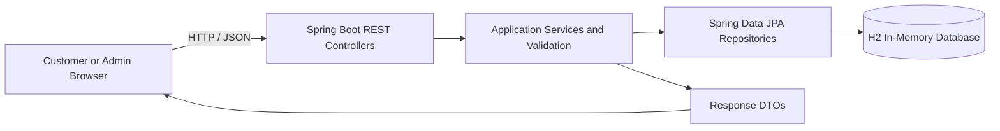
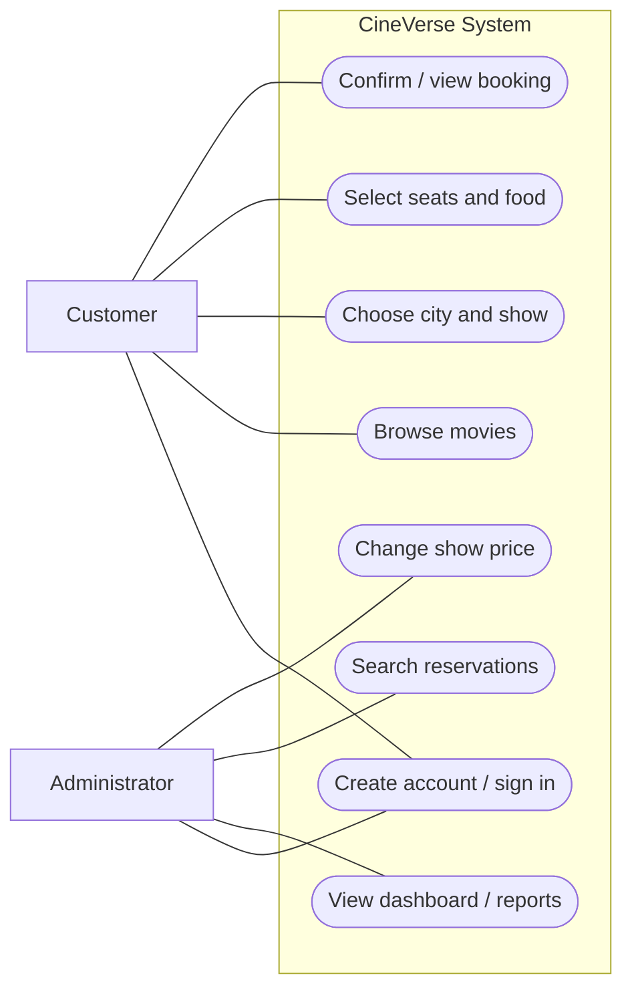
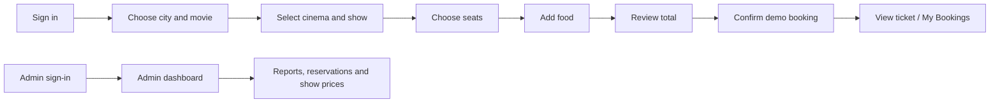
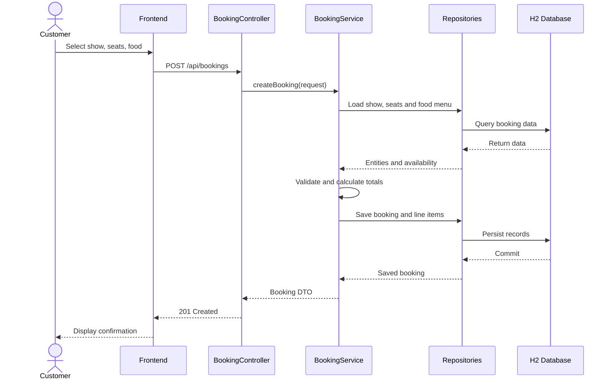
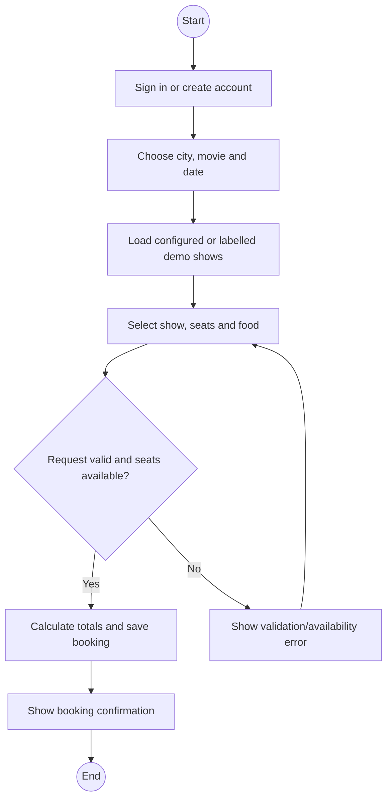
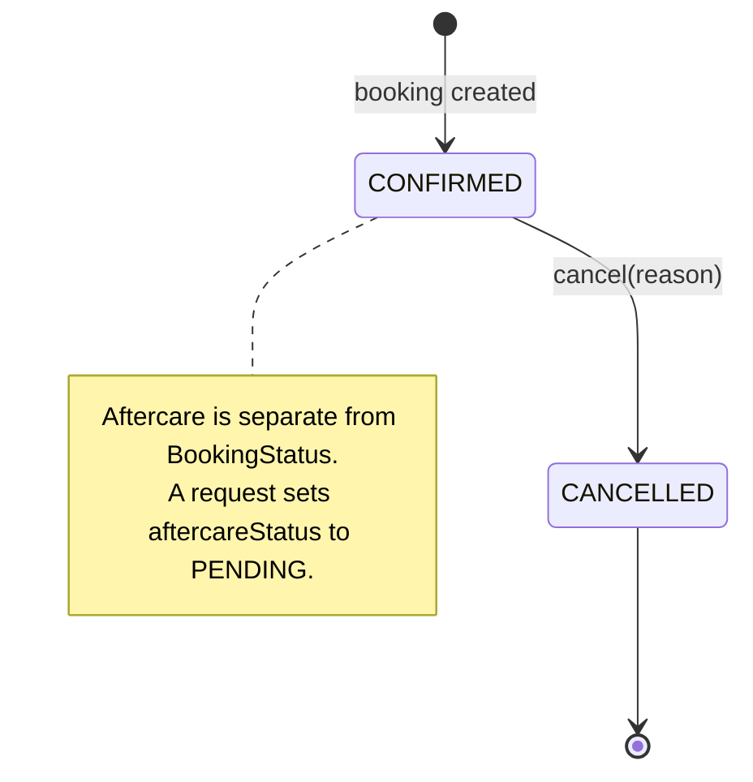
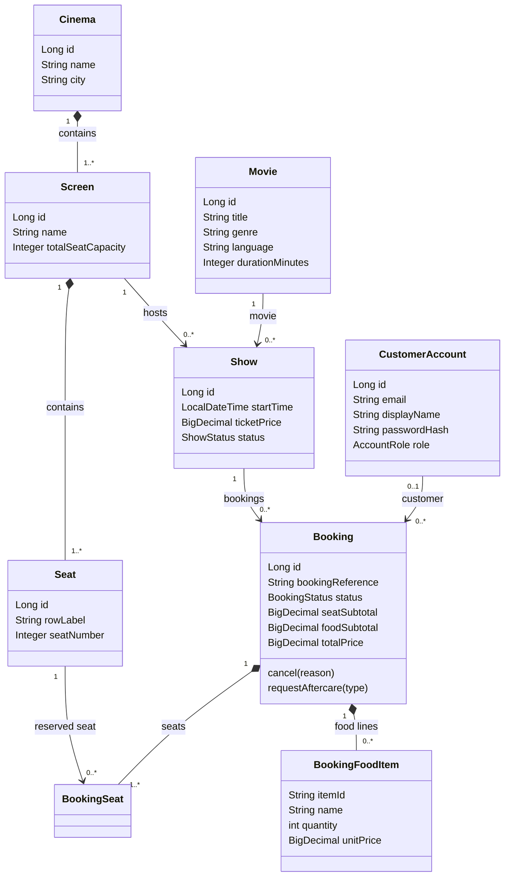
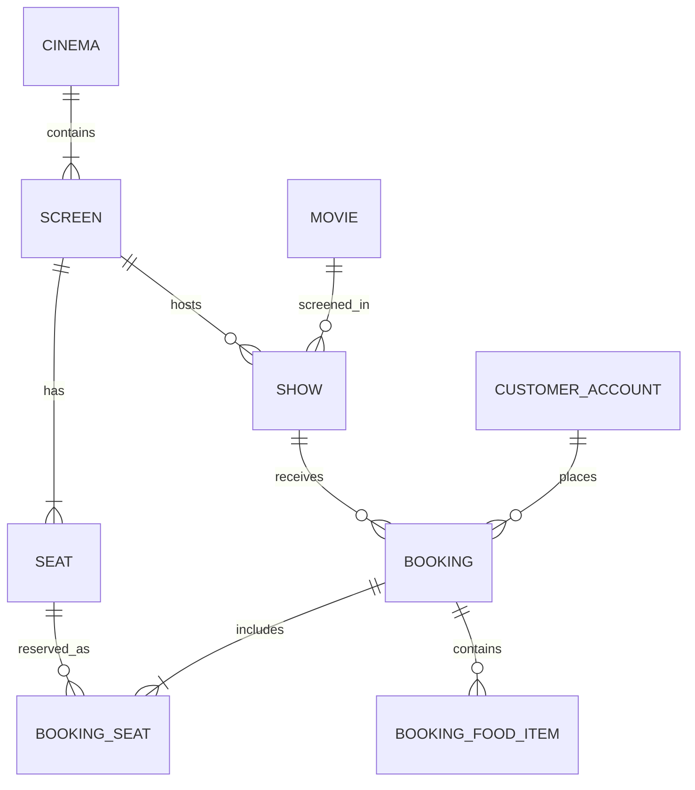

# CineVerse Movie Ticket Booking System

**Software Engineering Project Report**  
**Prepared by:** [Add team member names and student IDs]  
**Submitted to:** [Add faculty name, course, department and college]  
**Academic year:** 2026

> **Submission note:** This is a classroom demo. Demo cinemas/showtimes are simulated, payment is not processed, and the displayed booking QR/reference is illustrative, not scannable. The configured H2 database is in-memory and resets when the app restarts.

## Abstract
CineVerse is a web-based movie ticket booking system that lets customers select a city, browse movies, choose a cinema and showtime, reserve seats, add food items, and review a booking total. An administrator can access a protected dashboard to review booking reports and manage screening prices. The application uses a static HTML/CSS/JavaScript frontend, a Java 17 and Spring Boot backend, Spring Data JPA, and H2 in-memory persistence. This report describes the requirements, architecture, data model, implementation, interface evidence, test coverage, limitations and future work.

## 1. Introduction
Online movie booking involves coordinating location, movie, screening, seat availability and order totals in a clear workflow. CineVerse demonstrates this process in a browser-based application. The frontend manages customer interaction while the backend validates access and booking requests, calculates totals and persists booking data. A separate administration module provides booking summaries and screening-price controls.

### 1.1 Problem statement
Customers need a simple way to select a city and screening, understand seat and food charges before confirming, and retrieve their booking. Administrators need protected access to booking summaries and screening prices. CineVerse addresses these needs with a guided customer booking flow and a role-protected reporting module.

### 1.2 Objectives
- Provide customer registration, login and account-aware bookings.
- Support city, movie, cinema and show selection.
- Display seat availability and apply premium-seat pricing rules.
- Include food selections in the booking total.
- Save a booking and provide a confirmation/ticket view.
- Restrict administration features and provide booking reports.
- Demonstrate modular object-oriented design and backend validation.

### 1.3 Scope and constraints
**In scope:** account access, movie discovery/catalog, city and show selection, seat reservation, food orders, booking totals, ticket summary, admin reports and show-price management.

**Constraints:** the active configuration uses H2 in-memory with schema recreation, so records reset after restart. Payment outcomes are simulated. Some cinema/show choices are explicitly marked demo data, not real theatre availability. Maven declares a PostgreSQL driver, but the active datasource in `application.properties` is H2.

### 1.4 Stakeholders
| Stakeholder | Goal |
|---|---|
| Customer | Find a movie/show, select seats and food, confirm and retrieve a booking. |
| Administrator | Review booking reports and update screening prices. |
| Project team | Analyze, implement, test, document and maintain the prototype. |
| Faculty/evaluator | Assess requirements, design, implementation and testing evidence. |

## 2. Requirements specification
### 2.1 Functional requirements
| ID | Requirement |
|---|---|
| FR-01 | A visitor can register a customer account and sign in. |
| FR-02 | A customer can choose a city, browse movies and view movie details. |
| FR-03 | A customer can request cinemas and showtimes for a movie, city and date. |
| FR-04 | A customer can view seat availability and select seats for a show. |
| FR-05 | The backend calculates seat and food subtotals and the total. |
| FR-06 | A customer can confirm a demo booking and retrieve its summary. |
| FR-07 | A customer can access their bookings and submit eligible aftercare requests. |
| FR-08 | Admin sign-in checks Admin ID, email, password and ADMIN role. |
| FR-09 | An admin can view filtered reports and reservation data. |
| FR-10 | An admin can update a screening price for future bookings. |

### 2.2 Non-functional requirements
- **Security:** encoded passwords, role-based admin access and CSRF verification for state-changing requests.
- **Integrity:** backend validation and a uniqueness constraint prevent duplicate seat reservations for a show.
- **Usability:** sequential booking steps and visible notes distinguish demo inventory/payment.
- **Maintainability:** controllers, services, repositories, DTOs and entities have separate responsibilities.
- **Development portability:** Maven and embedded H2 avoid requiring an external database server.

## 3. Architecture and design
The application follows a client-server, layered design. The browser renders static frontend pages and calls REST endpoints. Controllers handle HTTP requests, services apply business rules, repositories use Spring Data JPA, and JPA entities map application data to relational tables.

**Figure 1.** Logical architecture. External payment processing is not implemented.

### 3.1 UML use-case diagram

**UML U1.** Customer and administrator use cases. Admin operations require an ADMIN account; admin sign-in also checks the configured Admin ID.

### 3.2 Customer booking workflow

**Figure 2.** Customer and administrator workflow.

### 3.3 UML booking sequence diagram

**UML U3.** Booking creation sequence. Payment is recorded as a simulated outcome only.

### 3.4 UML booking activity diagram

**UML U4.** Booking activity with validation and correction path.

### 3.5 UML booking state diagram

**UML U5.** Booking lifecycle based on the implemented BookingStatus enum. Aftercare is a separate field.

## 4. Data design
The JPA model includes accounts, movies, cinemas, screens, seats, shows and bookings. `BookingSeat` links a booking to a seat for a specific show; `BookingFoodItem` stores an item ID, name, quantity and unit price. A booking stores a reference, status, subtotals and total.

### 4.1 UML class diagram

**UML U2.** Simplified domain class diagram based on the JPA entities. Repository, controller and service classes are omitted to keep the domain model readable.

### 4.2 Entity relationship view

**Figure 4.** Simplified entity relationship view; a show references one movie and one screen, and a screen belongs to a cinema.

### 4.3 Key business rules
- One booking belongs to one show and may contain several seats and food lines.
- A unique constraint prevents the same seat from being reserved twice for one show.
- The backend, not browser-supplied values, calculates seat and food totals.
- Premium seats follow the configured front-row rule; standard seats use the base show price.
- Cancellation and aftercare states are recorded separately.
- Admin routes require an ADMIN role; admin login also verifies the configured Admin ID.

### 4.4 Main entities
| Entity | Purpose |
|---|---|
| CustomerAccount | Customer identity, encoded password and role. |
| Movie | Movie catalog data. |
| Cinema / Screen / Seat | Venue, screen and physical seating structure. |
| Show | Scheduled movie, screen, time, status and ticket price. |
| Booking | Reservation reference, status, subtotals and total. |
| BookingSeat | Association between booking, show and seat. |
| BookingFoodItem | Food line with item, quantity and unit price. |

## 5. Technology and implementation
| Layer | Technology |
|---|---|
| Frontend | Static HTML, CSS and JavaScript |
| Backend | Java 17, Spring Boot 3.5.7, REST controllers and service layer |
| Persistence | Spring Data JPA / Hibernate and H2 in-memory datasource |
| Build | Maven and Spring Boot Maven plugin |
| Tests | JUnit 5, Spring Boot Test and MockMvc |
| Version control | Git and GitHub |

### 5.1 Object-oriented concepts demonstrated
- **Encapsulation:** entities keep state private and expose operations/accessors.
- **Abstraction:** controllers use DTOs and services rather than exposing persistence entities directly.
- **Association:** domain relationships connect cinemas, screens, shows, movies, bookings, seats and food lines.
- **Separation of responsibilities:** controllers handle HTTP, services business rules, repositories persistence, DTOs API data.
- **Enums:** roles and booking/show/aftercare states use explicit domain values.
- **Validation:** request validation, session checks, role checks and server-side price calculation protect key operations.

### 5.2 Booking total
**Booking total = server-calculated seat subtotal + server-calculated food subtotal.** The checkout page presents payment choices, but completing the booking does not charge a payment method.

## Project Planning and Management
> **Plan status:** This is a proposed schedule and role template, not a claim about actual historical dates or individual contributions. Replace role placeholders with your group's real details.

| Phase | Suggested duration | Work and deliverables |
|---|---|---|
| Requirements | Week 1 | Confirm problem, users, scope, requirements and acceptance criteria. |
| Analysis and design | Week 2 | Review use cases, UML models, architecture, entity relationships and UI flow. |
| Implementation | Weeks 3-4 | Implement frontend, Spring Boot APIs, booking rules, persistence, admin functions and integration. |
| Verification | Week 5 | Run unit/integration/system tests, record defects, fix issues and repeat regression tests. |
| Documentation and demo | Week 5 | Prepare screenshots, report, presentation, run instructions and demonstration checklist. |

### Suggested responsibilities for a group of 2-3
| Role placeholder | Suggested ownership |
|---|---|
| Member A: [name / ID] | Requirements, UML, documentation and coordination. |
| Member B: [name / ID] | Backend entities/services/APIs, persistence and backend tests. |
| Member C: [name / ID, if applicable] | Frontend workflow, UI integration, screenshots and demo preparation. |
| Shared | Design reviews, integration testing, defect triage and final presentation. |

## 6. User-interface evidence
The following supplied screenshots document the customer and admin experience. Screenshots that reveal the user's personal email address were intentionally excluded. Demo cinema inventory, simulated payment and illustrative ticket references are described as such.

### 6.1 Home and featured movie

**Figure 5.** Homepage with featured film, navigation and city selector.

### 6.2 Movie details

**Figure 6.** Movie details page and booking entry point.

### 6.3 City and show-date selection

**Figure 7.** Selected city and show-date choices.

### 6.4 Cinema and showtime choices

**Figure 8.** Three available demo cinema options; these are not real theatre listings.

### 6.5 Seat and food selection

**Figure 9.** Seat layout, premium/standard legend, food quantities and displayed total.

### 6.6 Checkout review

**Figure 10.** Simulated checkout with itemized seat and food charges.

### 6.7 Booking confirmation

**Figure 11.** Demo booking details. The displayed QR/reference is illustrative and not scannable.

### 6.8 Admin dashboard

**Figure 12.** Dashboard metrics and date filters for the captured demo dataset.

### 6.9 Admin reports and reservations

**Figure 13.** Booking summaries, reservation search and CSV export controls.

## 7. Verification and testing
The repository contains Spring Boot/MockMvc test cases covering these behaviors:

| Area | Test coverage |
|---|---|
| Booking | Create a confirmed booking, calculate totals, verify seat availability and retrieve a booking. |
| Pricing / food | Verify premium and standard seat totals, food menu and persisted food line values. |
| Show fallback | Prefer configured shows and provide three explicitly flagged demo choices when appropriate. |
| Admin authentication | Reject customer roles, wrong Admin ID and use of the customer login endpoint; accept configured admin credentials. |
| Authorization / CSRF | Reject anonymous/customer report access and state-changing requests without valid CSRF verification. |
| Admin reporting | Filter dashboard data by show date and reject invalid date ranges. |

**Actual execution:** `mvn test` was run on 10 Nov 2026. Result: **52 tests, 49 passed, 3 failed, 0 errors, 0 skipped; BUILD FAILURE.** The three observed failures are listed below; their root causes have not yet been diagnosed.

| Failing test | Observed assertion |
|---|---|
| `AdminControllerTest.adminReportIsRoleProtectedAndFiltersBookingsByShowDate` | Expected `totalRevenue` 350.0; received 437.5. |
| `AuthControllerTest.customerBookingReportAndBookingLookupAreRestrictedToOwner` | Expected HTTP 201; received HTTP 400. |
| `CinemaShowControllerTest.developmentDataLoaderIsIdempotent` | Expected 3 records; found 10. |

All 15 `BookingControllerTest` cases passed. `DiscoveryControllerTest` passed 3/3, `HealthControllerTest` 1/1 and `MovieControllerTest` 12/12. `AdminControllerTest` and `AuthControllerTest` each had 3 passes and 1 failure; `CinemaShowControllerTest` had 12 passes and 1 failure.

### 7.1 Manual acceptance checks
| Check | Expected observation |
|---|---|
| Customer flow | City, movie, date, cinema and show carry forward through booking steps. |
| Seat selection | Selected seats appear in the summary; unavailable seats cannot be selected. |
| Food calculation | Food quantity affects food subtotal and total. |
| Confirmation | Booking details show seats, food, subtotals and simulated payment status. |
| Admin boundary | Customer accounts cannot access admin reports or price-management actions. |

## 8. Challenges, limitations and future work
### 8.1 Challenges and responses
- **Preserving user context:** carry the selected city and return route through frontend authentication/navigation.
- **Trustworthy totals:** calculate prices on the backend instead of trusting browser values.
- **Duplicate seat reservations:** check availability and enforce a per-show seat uniqueness constraint.
- **Sparse theatre inventory:** provide clearly labelled demo options when configured local data is absent.
- **Admin protection:** require role verification, configured Admin ID and CSRF checks.

### 8.2 Limitations
- H2 is in-memory under the current configuration; data resets after application restart.
- Payment processing is simulated; no real financial transaction occurs.
- Some cinema/show data is demonstration inventory, not live availability.
- The QR/reference shown in the ticket is illustrative and is not a scannable admission credential.
- Dashboard numbers in screenshots reflect the captured demo dataset, not production analytics.

### 8.3 Maintenance plan
| When | Maintenance activity |
|---|---|
| For every code change | Run focused tests and `mvn test`; review validation, authorization and booking-total behavior; update related documentation. |
| Each release | Build from a clean checkout, verify environment configuration, review logs and confirm demo/production labels. |
| Monthly or before a submission | Review Spring Boot/Maven dependency updates, security advisories, open defects and UI compatibility. |
| Before production use | Replace in-memory H2 with persistent storage, add migrations/backups, protect secrets, configure monitoring and integrate real payment processing. |
| After an incident | Reproduce the issue, preserve diagnostic logs without secrets, add a regression test, fix and re-verify. |

Assign a maintainer for each release. Keep admin credentials and API keys in environment/configuration secrets, never in source control.

### 8.4 Future enhancements
- Use persistent database storage with migrations and backups.
- Integrate a compliant payment provider and transaction-status handling.
- Issue verifiable QR tickets and support venue entry validation.
- Connect to live cinema/showtime inventory.
- Add notifications, accessibility improvements, reviews and richer analytics.

## 9. Conclusion
CineVerse demonstrates a complete movie reservation workflow and applies software-engineering practices across requirements, modular design, persistence, access control, pricing and testing. It supports movie discovery, show selection, seat and food choices, server-calculated totals, ticket summaries and admin reporting. The current H2 and payment configuration is suitable for a classroom demo, not a live ticketing service. Persistent storage, live inventory and real payment processing remain future extensions.

## References
- Spring Boot Reference Documentation: https://docs.spring.io/spring-boot/
- Spring Data JPA Reference Documentation: https://docs.spring.io/spring-data/jpa/
- H2 Database Documentation: https://www.h2database.com/
- Java Platform Documentation: https://docs.oracle.com/en/java/
- CineVerse source code, README and automated test sources.

## Appendix A. Running the project
From the project root, run `mvn spring-boot:run`. The default port is 8080 and can be overridden with the `PORT` environment variable. The development database is embedded H2, so no separate database installation is required. Do not include passwords, Admin IDs or private environment values in the submitted report.
